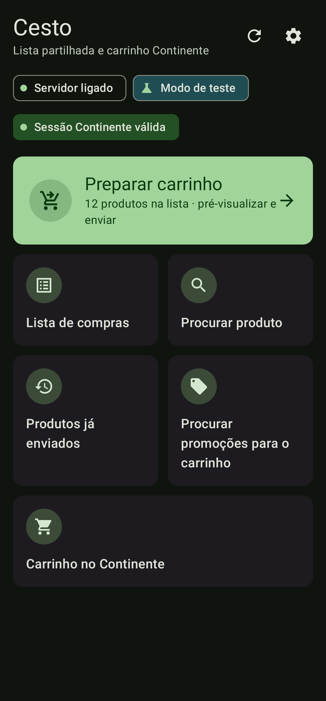
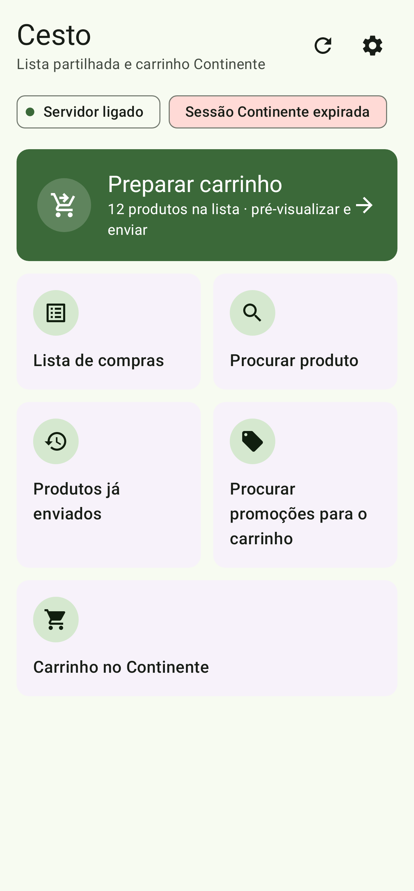
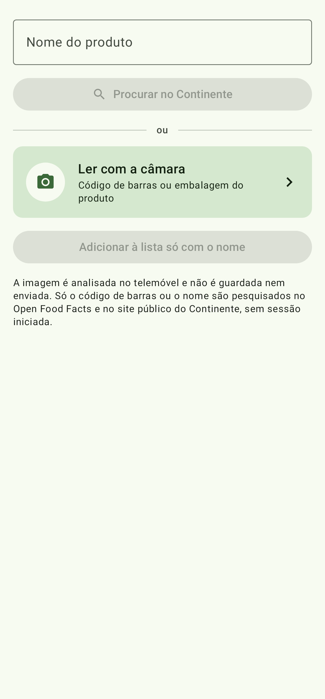
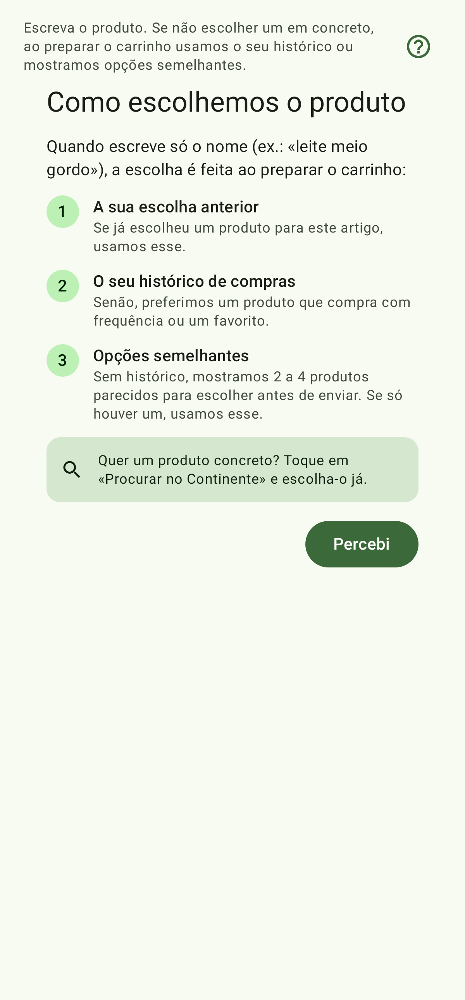
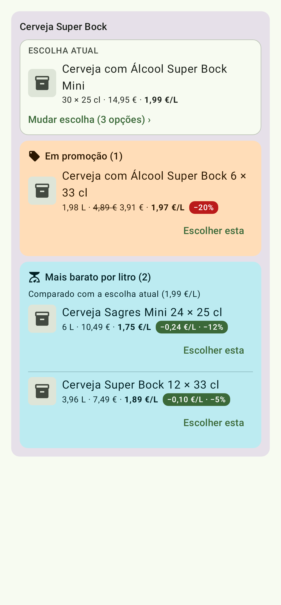
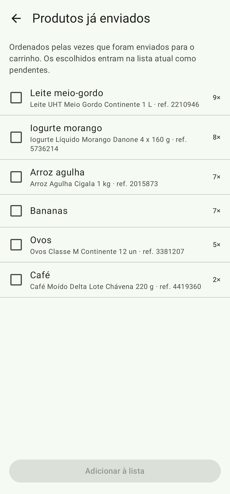
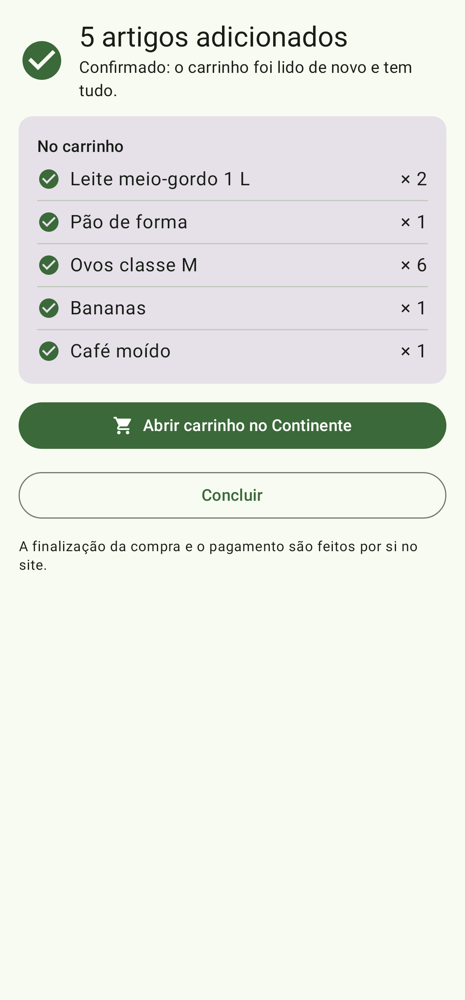
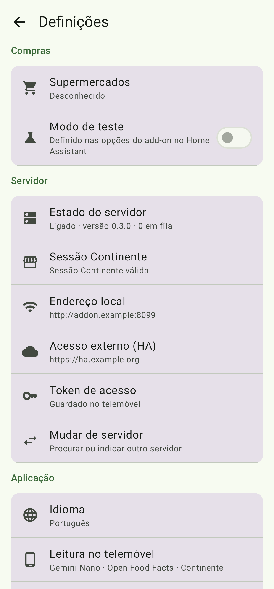

<!--
  Public product page for Cesto. Canonical source; copied as-is to jpch/cesto-releases/README.md
  on every v* release. Keep it in European Portuguese and user-facing only (no internals, no
  links to private repositories). Image paths are relative to the cesto-releases repo root.
-->
# Cesto

Cesto é uma app Android para a lista de compras da casa. A lista é partilhada por todos e, através do add-on Cesto no Home Assistant, transforma-se no carrinho do supermercado — começando pelo Continente.
A app prepara o carrinho e mostra-o antes de o alterar, mas nunca finaliza a compra nem paga: isso fica sempre do teu lado.

## Ecrãs

| | | |
|:---:|:---:|:---:|
|  Início |  Início (escuro) |  Sessão expirada |
|  Procurar produto |  Resultados da procura |  Como escolhemos o produto |
|  Promoções |  Vista geral das promoções |  Produtos já enviados |
|  Produtos já enviados (selecionados) |  A enviar para o carrinho |  Resultado |
|  Artigos em falta |  Definições | |

## Funcionalidades

- **Lista partilhada.** Todos os telemóveis da casa veem a mesma lista, guardada no add-on. As alterações feitas sem ligação ficam no telemóvel e são enviadas na próxima sincronização.
- **«Procurar produto».** Escreve o nome ou usa a câmara para ler o código de barras ou o texto da embalagem. O produto escolhido vai para a lista, nunca diretamente para o carrinho.
- **«Preparar carrinho».** O Cesto procura cada artigo da lista no supermercado e mostra uma pré-visualização antes de mexer no carrinho: podes juntar ao que já lá está ou substituir. Não finaliza compras nem paga; «Carrinho no Continente» apenas abre o site.
- **«Procurar promoções».** Para cada produto mostra as promoções, o preço por litro ou por kg e as alternativas «Mais barato por litro/kg». Começa por uma vista geral com filtros (Todos, Promoção, Mais barato, Sem nada).
- **«Produtos já enviados».** Os produtos que já foram para o carrinho, os mais frequentes primeiro. Seleciona vários e volta a pô-los na lista de uma vez.
- **«Como escolhemos o produto».** Uma explicação curta de como o add-on escolhe o produto para cada artigo da lista.
- **Fora de casa.** Com a opção `remote_cart` ligada no add-on, a app funciona através do Home Assistant e o indicador mostra «Fora de casa (via Home Assistant): lista e carrinho». Com a opção desligada, fora de casa só a lista está disponível. Finalizar a compra e pagar continuam a ser impossíveis.
- **Estado da sessão.** Indicadores no início mostram «Sessão Continente válida», a sessão expirada ou «Add-on Continente indisponível». Com o add-on 2.0.0 ou mais recente, a sessão do Continente vive no add-on Continente MCP; «Iniciar sessão no Continente» abre a página desse add-on no Home Assistant.
- **Idioma.** Português europeu por omissão; no ecrã inicial podes mudar para inglês ou para o idioma do telemóvel.

## Requisitos

- Home Assistant com o add-on [Cesto](https://github.com/jpch/cesto-ha) 2.0.0 ou mais recente.
- O add-on [Continente MCP](https://github.com/jpch/continente-mcp-ha), que guarda a sessão do Continente.
- Android 8.0 ou mais recente.

## Instalação

1. Instala o [Obtainium](https://github.com/ImranR98/Obtainium) e adiciona uma app com o URL `https://github.com/jpch/cesto-releases`. O Obtainium avisa quando há uma versão nova.
2. Liga o telemóvel ao add-on: na página do add-on Cesto no Home Assistant, abre «Ligar um telemóvel» e lê o código QR com a app. Em alternativa, usa «Procurar na rede» (porta 8099) ou escreve os dados à mão.

**Vens da app antiga?** O pacote antigo `pt.jpch.assistentecompras` foi substituído por `app.cesto`. As duas apps instalam-se lado a lado; liga a nova ao add-on e desinstala a antiga. A lista está no add-on, por isso não se perde nada.

## Verificar o APK

Todos os APK são assinados com o mesmo certificado. SHA-256 do certificado de assinatura:

`62:B9:14:53:C8:27:8B:DB:B3:46:FF:BD:9A:80:3C:59:8B:2A:6F:D7:87:56:B4:54:25:86:80:52:58:5A:57:10`

Cada versão publicada em [Releases](https://github.com/jpch/cesto-releases/releases) inclui também o sha256 do respetivo APK, para confirmares o ficheiro descarregado (`sha256sum cesto-X.Y.Z.apk`).

## O que há de novo

**1.8.0**
- Compatível com o add-on Cesto 2.0.0: a sessão do Continente passa a viver no add-on Continente MCP. Um indicador vermelho «Add-on Continente indisponível» avisa quando esse add-on não responde.
- «Iniciar sessão no Continente» abre a página do add-on Continente MCP no Home Assistant. Não é preciso voltar a ligar o telemóvel.

Histórico completo em [CHANGELOG.md](CHANGELOG.md) e em [Releases](https://github.com/jpch/cesto-releases/releases).

## Projetos relacionados

- [cesto-ha](https://github.com/jpch/cesto-ha) — add-on Cesto para o Home Assistant.
- [continente-mcp-ha](https://github.com/jpch/continente-mcp-ha) — add-on Continente MCP (sessão do Continente).

## Licença

MIT.
