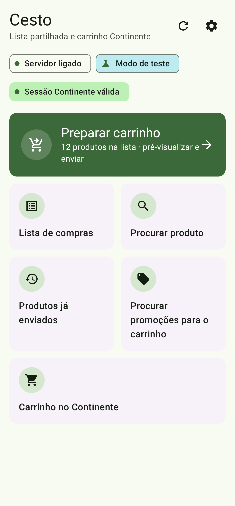
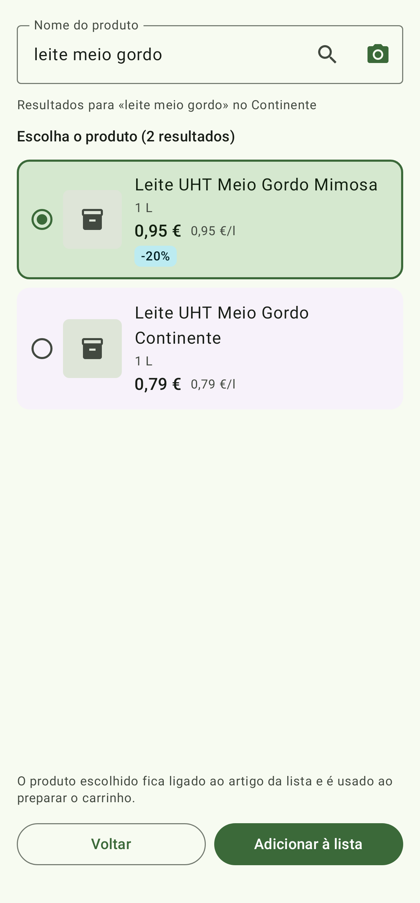
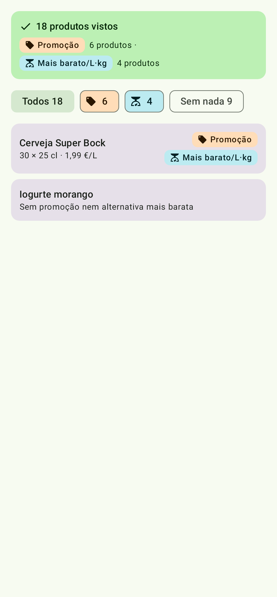
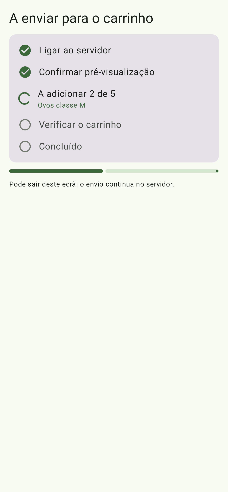
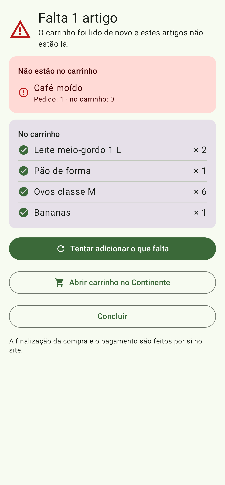
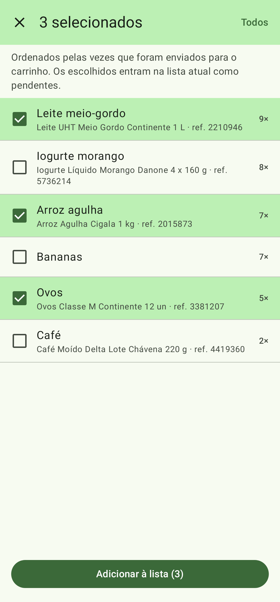

<!--
  Public product page for Cesto. Canonical source; copied as-is to jpch/cesto-releases/README.md
  on every v* release. Keep it in European Portuguese and user-facing only (no internals, no
  links to private repositories). Image paths are relative to the cesto-releases repo root.
-->
# Cesto

Cesto é uma app Android para a lista de compras da casa. A lista é partilhada por todos e, através do add-on Cesto no Home Assistant, transforma-se no carrinho do Continente.
A app prepara o carrinho e mostra-o antes de o alterar, mas **nunca finaliza a compra nem paga**: isso fica sempre do teu lado.

## Requisitos

- Home Assistant com o add-on [Cesto](https://github.com/jpch/cesto-ha) e o add-on [Continente MCP](https://github.com/jpch/continente-mcp-ha), que guarda a conta e a sessão do Continente.
- Android 8.0 ou mais recente.

## Instalação

1. Instala o [Obtainium](https://github.com/ImranR98/Obtainium) e adiciona uma app com o URL `https://github.com/jpch/cesto-releases`. O Obtainium avisa quando há uma versão nova. Também podes descarregar o APK em [Releases](https://github.com/jpch/cesto-releases/releases).
2. Na página do add-on Cesto no Home Assistant, abre «Ligar um telemóvel» e lê o código QR com a app. Em alternativa, usa «Procurar na rede» ou escreve os dados à mão.
3. Para usar fora de casa (opcional), indica nas Definições, em «Acesso externo (HA)», o endereço externo do Home Assistant e um token de acesso de longa duração, de preferência de um utilizador sem permissões de administrador.

## Como usar

| | | |
|:---:|:---:|:---:|
|  Início |  Procurar produto |  Promoções |
|  A enviar para o carrinho |  Resultado |  Produtos já enviados |

1. **Início.** Mostra o estado do servidor, do modo de teste e da sessão do Continente. Se a sessão expirou, «Iniciar sessão no Continente» abre a página do add-on Continente MCP.
2. **«Lista de compras».** Escreve os artigos, um por linha e com quantidades (por exemplo, `2 kg batata`). Todos os telemóveis da casa veem a mesma lista; o que fizeres sem ligação é enviado na próxima sincronização.
3. **«Procurar produto».** Escreve o nome ou usa a câmara para ler o código de barras ou o texto da embalagem. O produto vai para a lista, nunca diretamente para o carrinho.
4. **«Preparar carrinho».** Confirma o produto de cada artigo, vê as promoções e as alternativas «Mais barato por litro/kg», pré-visualiza e confirma: podes juntar ao que já está no carrinho ou substituí-lo. Os artigos em falta aparecem no fim. Termina a compra na app ou no site do Continente («Carrinho no Continente»).
5. **«Produtos já enviados».** Seleciona produtos que já foram para o carrinho e volta a pô-los na lista.

Fora de casa, a lista funciona sempre; o carrinho e as promoções funcionam quando a opção `remote_cart` está ligada no add-on Cesto.

## Segurança

- Não há forma de finalizar a compra, pagar ou fazer encomendas, nem na app nem nos add-ons.
- Cada telemóvel tem o seu token, guardado cifrado no telemóvel; podes revogá-lo na página do add-on Cesto. A app nunca vê a password do Continente.
- As imagens da câmara são lidas no telemóvel e nunca são guardadas nem enviadas.

## Verificar o APK

Todos os APK são assinados com o mesmo certificado. SHA-256 do certificado de assinatura:

`62:B9:14:53:C8:27:8B:DB:B3:46:FF:BD:9A:80:3C:59:8B:2A:6F:D7:87:56:B4:54:25:86:80:52:58:5A:57:10`

Cada versão em [Releases](https://github.com/jpch/cesto-releases/releases) inclui o sha256 do APK (`sha256sum cesto-X.Y.Z.apk`). Novidades em [CHANGELOG.md](CHANGELOG.md).

## Licença

MIT.
